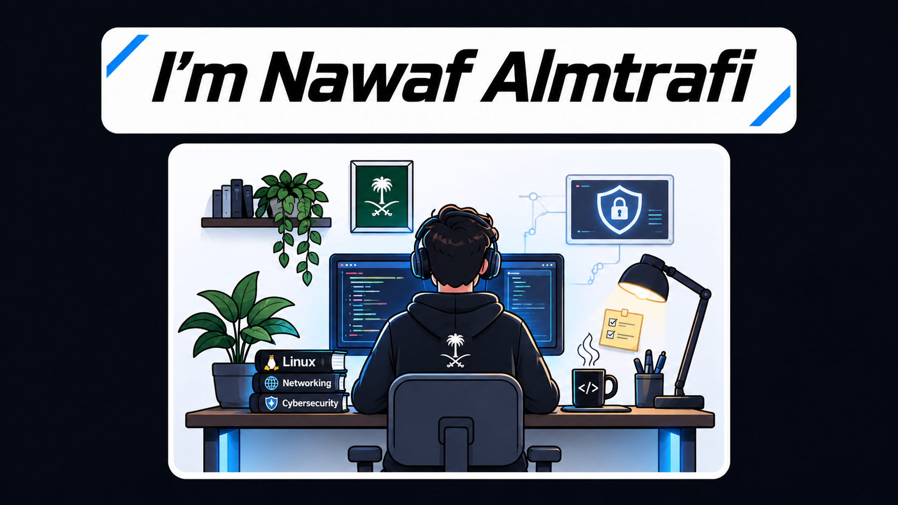

  

<h1 align="center">Hi 👋, I'm Nawaf</h1>

  🔐 Cybersecurity Enthusiast &nbsp; | &nbsp; 🐧 Linux Foundations &nbsp; | &nbsp; 🌐 Networking Journey

  

---

### 👨‍💻 About Me

- 🐧 Completed my Linux foundation
- 🌐 Currently starting my journey in Computer Networking
- 🔐 Interested in Cybersecurity and continuously developing my skills
- 🛡️ Presented a project focused on Phishing Detection
- 🌱 Always learning and exploring new technologies

---

### 🚀 My Learning Journey

🐧 <b>Linux Foundations</b> &nbsp; → &nbsp; 🌐 <b>Networking</b> &nbsp; → &nbsp; 🔐 <b>Cybersecurity</b>

---

<h3>🤖 AI Phishing Detector</h3>

An AI-powered project designed to analyze URLs and detect potential phishing attempts by identifying suspicious patterns and security indicators.

  🔗 <a href="https://github.com/NawafCyber/AI-Phishing-Detector">
    Click here to view the project
  </a>

---

### 🛠️ Current Skills & Learning

  🐧 Linux &nbsp;&nbsp; | &nbsp;&nbsp;
  🌐 Networking &nbsp;&nbsp; | &nbsp;&nbsp;
  🔐 Cybersecurity

---

### 🔗 Connect With Me

  

---

### 📊 GitHub Stats

  

---

  🌱 <i>Building my knowledge, one step at a time.</i>

  ⭐ Feel free to explore my repositories and follow my journey!

